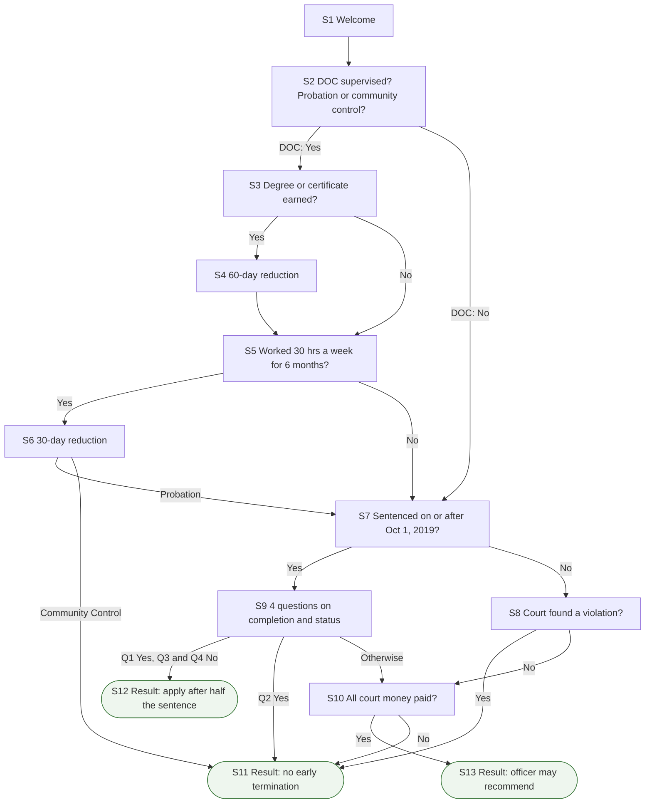

# Florida Early Termination Tool

A bilingual (English and Spanish) web tool from REFORM Alliance that helps people on probation or community control in Florida see which sentence credits they have earned and whether they can seek early termination. It applies only to probation and community control, not parole.

**Live app:** <https://bfs6-florida-early-termination-tool.share.connect.posit.cloud/>

Part of REFORM Alliance's early termination tools: [Georgia](https://github.com/REFORM-Alliance/georgia-early-termination-tool) · **Florida** · [Illinois](https://github.com/REFORM-Alliance/illinois-early-termination-tool) · [Virginia](https://github.com/REFORM-Alliance/va-implementation-tool) · [Pennsylvania Act 44](https://github.com/REFORM-Alliance/act-44-flow-chart-app).

## What it tells people

- **Credits:** a 60-day reduction for each degree or vocational certificate earned, and a 30-day reduction for every 6 months of qualifying work. Asked only of people supervised by the Department of Corrections (DOC).
- **After half the sentence:** people sentenced on or after October 1, 2019 who completed their conditions, have no court-found violation, did not waive early termination in a plea and are not a "violent felony offender of special concern" may apply once half the probation sentence is served.
- **Officer recommendation:** where no violation was found and all court money is paid, the probation officer may recommend early termination at any time.
- **No early termination:** community control, a court-found violation, or unpaid fines, costs or restitution lead to a result saying Florida law offers no opportunity.

## How the flow works

The tool is a scripted question-and-answer flow. A person answers one screen at a time, their answers choose the next screen, and a result screen says what they can do. Screens are numbered in the order a person meets them; each screen's code ID is its `question_id` in `app.R` (listed below the diagram).

Rounded boxes are result screens. S6 branches on the probation or community control answer given at S2.

Screen numbers and code IDs

| Screen | `question_id` |
| --- | --- |
| S1 | `intro_page` |
| S2 | `initial_question` |
| S3 | `education_question` |
| S4 | `60_day_reduction_message` |
| S5 | `employment_question` |
| S6 | `30_day_reduction_message` |
| S7 | `sentencing_date_question` |
| S8 | `violation_of_probation_question` |
| S9 | `probation_status_questions` |
| S10 | `fines_fees_question` |
| S11 | `no_early_termination_result` |
| S12 | `half_early_termination_result` |
| S13 | `early_termination_result` |

## Repository layout

| File or folder | What it is |
| --- | --- |
| `app.R` | The whole app: packages, the `decision_tree` list (every screen and its routing), page layout and server logic. |
| `json/translation.json` | English-to-Spanish text pairs. The English text is the lookup key. |
| `www/reform-logo-charcoal.png` | The logo at the top of the page. Shiny serves everything in `www/` as-is. |
| `renv.lock`, `renv/`, `.Rprofile` | Pinned package versions. `.Rprofile` switches renv on when the project opens. |
| `manifest.json` | The R version and package list that Posit Connect Cloud builds the app from. Regenerate it with `rsconnect::writeManifest()` after any package change. |
| `florida-early-termination-tool.Rproj` | The RStudio project file. The app finds `json/translation.json` relative to it. |

The pinned versions are R 4.5.0 with the packages in `renv.lock`. The app loads `shiny`, `tidyverse`, `shinythemes`, `shinyWidgets`, `shinyjs`, `shinyalert`, `shiny.i18n`, `lubridate`, `scales`, `here`, `rsconnect` and `googleLanguageR`. The last two are loaded but never called, so no Google or hosting credentials are needed to run it.

## Run it locally

1. Install R 4.5.0 and the RStudio desktop app.
2. Clone or download this repo and double-click `florida-early-termination-tool.Rproj`. RStudio opens the project and renv switches on by itself.
3. In the R console, run `renv::restore()` once. It installs the pinned package versions.
4. Open `app.R` and click **Run App**, or run `shiny::runApp()` in the console.
5. Switch the language picker to Spanish and click through every route you changed.

## Edit wording, questions and Spanish

- Each screen is one block in the `decision_tree` list at the top of `app.R`: `question_id` (its name), `question` or `result` (the text), `choices` (the answer buttons) and `next_question` (where each answer leads).
- After changing any English text, make the matching change to the `"en"` value in `json/translation.json` and rewrite its `"es"` value. Matching is exact, including punctuation and curly quotes, and text is translated in pieces around links and bold words. A miss shows that piece in English and logs a warning.
- Screen names must be unique and every name in `next_question` must exist, or Next does nothing. Keep the first screen as the welcome screen.
- Link to a statute with `tags$a(href='URL', target='_blank', class='external-link', "text")`. The `external-link` class triggers the "Leaving Application" confirmation.
- English and Spanish are written into the picker and the answer-lookup code in several places, so a third language needs code changes as well as a new column.

## Publish

This tool is hosted on [Posit Connect Cloud](https://connect.posit.cloud). The live app is at <https://bfs6-florida-early-termination-tool.share.connect.posit.cloud/>. Connect Cloud copies the code from the GitHub repository and builds the app itself, so publishing an update means getting the change onto the GitHub branch that Connect Cloud follows (normally `main`; **Settings > Source** in Connect Cloud shows which). Nothing is uploaded from your computer. Connect Cloud addresses have the form `https://<account>-<custom name>.share.connect.posit.cloud`. The early termination tools' addresses of that form begin with `bfs6`, the name of the Connect Cloud account that owns them.

### Publish an update

1. Make and test the change on your computer (see **Run it locally**).
2. If you added or upgraded an R package, run `renv::snapshot()` and then `rsconnect::writeManifest()` in the R console, and commit both `renv.lock` and `manifest.json`. Connect Cloud reads `manifest.json` for the package list, so a stale one gives the live app the wrong packages or fails the build.
3. Commit and push to `main` (RStudio's Git tab, GitHub Desktop or the command line all work), or merge a pull request into it. "Automatically publish on push" is on by default, so Connect Cloud rebuilds and redeploys the app. The address does not change.
4. Open the live address, switch the language picker to Spanish and click through the routes you changed.
5. If the live app did not change, sign in to Connect Cloud, open the app's card on your Home page and look at the publish log for an error. **Republish** on the card redeploys from the latest code on GitHub.

### Publish for the first time, or re-create the app

1. In the project folder, run `rsconnect::writeManifest()` in the R console. Commit and push `app.R`, `manifest.json`, `json/` and `www/`.
2. Sign in to [Connect Cloud](https://connect.posit.cloud) with the account named `bfs6`, which owns the `share.connect.posit.cloud` addresses.
3. Click **Publish** at the top of your Home page. The first time, Connect Cloud asks you to install its GitHub App; give it access to this repository. A repo owned by the REFORM-Alliance organization may need an organization owner to approve the app.
4. Choose **Shiny**, then select this repository.
5. Confirm the **Branch** is `main` and the **Primary file** is `app.R`. Leave **Automatically publish on push** on.
6. Click **Publish** and watch the build log. When it finishes, the app is live at an address like `https://<content id>.share.connect.posit.cloud`.
7. Open the app's **Settings > URL** and set the custom name to `florida-early-termination-tool`. The address becomes `https://bfs6-florida-early-termination-tool.share.connect.posit.cloud`.
8. Open the address in a private browser window to check that someone who is not signed in to Connect Cloud can use it.

### If something goes wrong

- **The repository is missing from the Publish list.** Connect Cloud's GitHub App does not have access to it. Give the app access in GitHub, then reload the list. Automatic publishing also only works for repositories the app can reach.
- **Free accounts can publish only public repositories.** If this repository is ever made private, the Connect Cloud account needs a paid plan.
- **The build fails after a package change.** Run `rsconnect::writeManifest()` again, commit `manifest.json` and push.
- **No secrets to set.** `app.R` reads no environment variables, so nothing is needed under Advanced settings.

## Known issues

Found by reading the code; the app was not run. Confirm each before changing anything.

- The community-control check happens only at S6. A community-control respondent who answers No at S5, or who answers No to the DOC question at S2, continues to S7 and can reach the probation outcomes S12 or S13. Confirm whether community control should always end at S11.
- S11 is also shown to probationers (a violation, unpaid court money, or a disqualifying answer at S9), yet its wording speaks of community control.
- Only Fla. Stat. 948.06(8)(b) and 948.001 are cited on screen. The 60-day and 30-day credits and the October 1, 2019 date carry no citation.
- Typo in user-facing text: "oppportunities" (S6). It is also a key in `json/translation.json`; fix both.
- This is the only tool with the per-question choice lists used at S2 (`choices` as a list); the same engine in the other repos does not have it.

## Keep the sibling repos in step

The five early termination tools copy the same engine rather than sharing a package. A fix to how the app behaves, as opposed to what it says, should be repeated in the other repos.

| Tool | Repository | Live app |
| --- | --- | --- |
| Georgia | [georgia-early-termination-tool](https://github.com/REFORM-Alliance/georgia-early-termination-tool) | <https://bfs6-georgia-early-termination-tool.share.connect.posit.cloud/> |
| Florida | [florida-early-termination-tool](https://github.com/REFORM-Alliance/florida-early-termination-tool) | <https://bfs6-florida-early-termination-tool.share.connect.posit.cloud/> |
| Illinois | [illinois-early-termination-tool](https://github.com/REFORM-Alliance/illinois-early-termination-tool) | <https://bfs6-illinois-early-termination-tool.share.connect.posit.cloud/> |
| Virginia | [va-implementation-tool](https://github.com/REFORM-Alliance/va-implementation-tool) | <https://www.reformvaearlyterminationtool.com/> |
| Pennsylvania Act 44 | [act-44-flow-chart-app](https://github.com/REFORM-Alliance/act-44-flow-chart-app) | <https://bfs6-act-44-early-termination-tool.share.connect.posit.cloud/> |